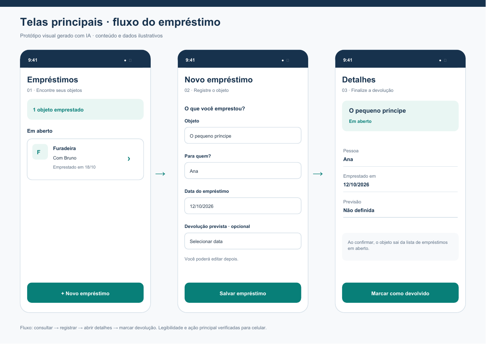
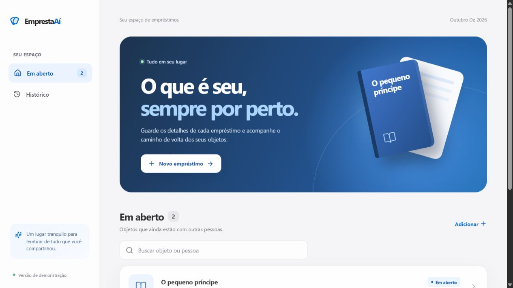

# EmprestaAí

Projeto de Alex desenvolvido em etapas a partir das aulas de prototipação e front-end com IA.

O EmprestaAí ajuda a registrar objetos emprestados, consultar com quem estão e marcar sua devolução.

## Entrega da Aula 1

- [Documento e telas em PDF](entrega-aula1/Alex_Aula1_EmprestaAi.pdf)
- [Prévia das três telas principais](entrega-aula1/telas-principais.png)

O PDF inclui problema, persona provisória, histórias de usuário, requisitos priorizados com MoSCoW, escopo do MVP, hipóteses a verificar, perguntas de descoberta, plano de teste e as telas do fluxo principal.



## Aula 2 — Front-end navegável

O front-end transforma o protótipo em uma interface responsiva, com visual limpo, superfícies translúcidas e animações suaves. Ele contém:

- lista de empréstimos em aberto com busca;
- formulário de novo empréstimo com validação;
- detalhes de cada objeto e edição do registro;
- confirmação de devolução e histórico;
- dados de exemplo armazenados no navegador, sem back-end nesta etapa;
- navegação adaptada para desktop e celular, com suporte a teclado e redução de movimento.



### Executar localmente

Requer Node.js e npm.

```bash
npm install
npm run dev
```

Abra o endereço local exibido pelo Vite. Para conferir a versão de produção, execute `npm run build`.

Os dados iniciais são fictícios. Em um navegador de desktop, o link **Restaurar dados de exemplo** no rodapé permite voltar a eles.

## Próximas etapas

1. **Aula 1 — Prototipação:** documento e telas entregues; entrevistas e teste com usuários ainda pendentes.
2. **Aula 2 — Front-end:** interface navegável e responsiva implementada com dados de exemplo.
3. **Back-end:** persistir empréstimos e implementar autenticação e operações de cadastro, consulta, edição e devolução.
4. **MVP completo:** conectar front-end e back-end e testar o fluxo completo com usuários.

As etapas 3 e 4 representam o planejamento do projeto. Seus critérios específicos serão ajustados conforme as aulas correspondentes.
