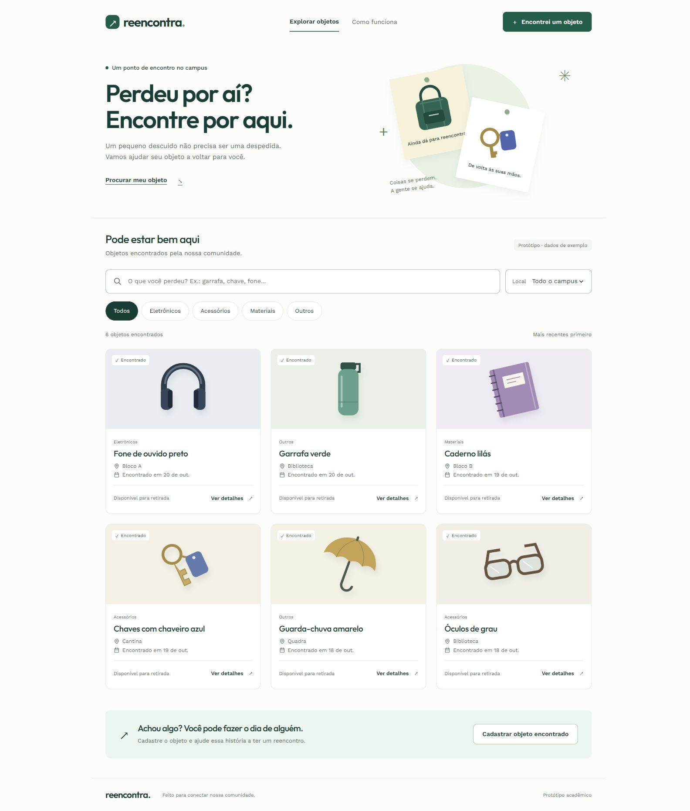

# Reencontra - Prototipação com IA

Projeto acadêmico da Aula 1 de Prototipação com IA e UI/UX: uma proposta de achados e perdidos para a faculdade.

## Telas do protótipo

A apresentação visual principal está em **imagens**, com o layout da primeira versão:

- [Tela inicial](imagens-prototipo/01-tela-inicial.jpg)
- [Detalhes do objeto](imagens-prototipo/02-detalhes-do-objeto.jpg)
- [Cadastro de objeto](imagens-prototipo/03-cadastro-de-objeto.jpg)
- [Baixar todas as imagens](imagens-prototipo/Reencontra-telas.zip)



## Documentação da aula

- [Problema, persona, histórias de usuário e escopo MoSCoW](entrega-aula1/documento.md)
- [Documento curto em PDF](entrega-aula1/SeuNome_Aula1_Reencontra.pdf)
- [Telas da versão simplificada em PDF](entrega-aula1/SeuNome_Aula1_Reencontra_Telas.pdf)

A documentação e o PDF de telas registram a etapa simplificada do projeto. As imagens em `imagens-prototipo/` mostram a proposta visual mais elaborada escolhida depois. A persona é hipotética e os testes com usuários ainda não foram realizados. Antes de entregar os PDFs, preencha seu nome e substitua `SeuNome` nos arquivos.

## Código das versões

| Pasta | Conteúdo |
| --- | --- |
| `imagens-prototipo/` | Imagens finais de apresentação e ZIP |
| `versoes/primeira-versao/` | Código do layout visual usado nas imagens |
| `dist/` | Wireframe simplificado navegável, em preto e branco |
| `entrega-aula1/` | Documento curto, PDFs e capturas da versão simplificada |
| `gerar-entrega.py` | Script que gera os PDFs a partir do documento e das capturas |

Para visualizar uma versão localmente, abra seu `index.html` ou execute:

```sh
python -m http.server 8000 --directory versoes/primeira-versao
```

Acesse http://localhost:8000. Para o wireframe, troque o diretório por `dist`.

HTML, CSS e JavaScript, sem backend. Os dados são fictícios. Na primeira versão, cadastros são salvos somente no navegador; no wireframe, desaparecem ao atualizar a página. As fontes da primeira versão são carregadas pelo Google Fonts com fallback local.

A IA foi usada para organizar a ideia, propor requisitos e gerar as interfaces. O objetivo é prototipar e discutir a experiência do usuário; não é um sistema de achados e perdidos em operação.

Para executar `gerar-entrega.py`, instale `reportlab`, `Pillow` e `pypdfium2`. O script depende das capturas presentes em `entrega-aula1/telas/` e gera previews em `tmp/pdfs/`.
