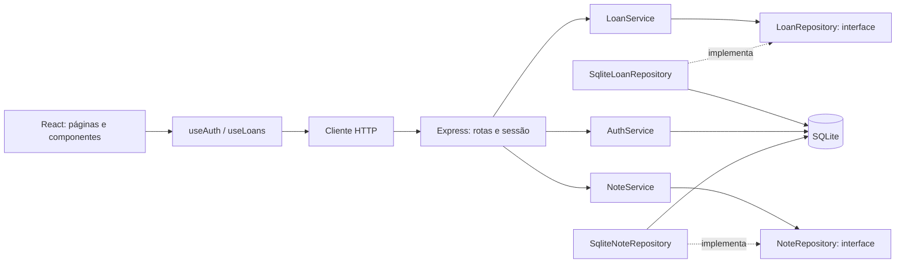

# Arquitetura do EmprestaAí

## Responsabilidades

- `src/pages` e `src/components`: apresentação, navegação, formulários e feedback.
- `src/application`: estado da interface e operações assíncronas.
- `src/infrastructure/LoanApi.ts` e `NoteApi.ts`: clientes HTTP, sem regras de negócio.
- `src/domain`: entidade, contrato de repositório, validação e transições do empréstimo.
- `server/app.ts`: rotas, autenticação obrigatória e conversão de erros em respostas HTTP.
- `server/AuthService.ts`: cadastro, verificação de senha e sessões.
- `server/SqliteLoanRepository.ts`: operações SQL sempre limitadas ao usuário autenticado.
- `src/domain/note.ts`: dados, contrato e validação da emissão demonstrativa.
- `server/SqliteNoteRepository.ts`: notas persistidas e numeradas em transação por usuário.
- `server/database.ts`: abertura do banco e criação idempotente do esquema.

`LoanService` recebe `LoanRepository` por construtor. O servidor instancia o serviço com um repositório vinculado ao ID da sessão, mantendo as regras de domínio sem dependência de Express ou SQLite. Componentes React são funções, conforme a convenção do framework; classes são usadas para serviços e adaptadores que encapsulam comportamento.

`NoteService` segue o mesmo princípio. O número da nota é atribuído em transação no repositório SQLite, com unicidade por usuário. Emitente e data são registrados no momento da emissão. A nota não possui chave de acesso ou protocolo de autorização e nunca é transmitida à SEFAZ.

O formulário fiscal simulado agora guarda um instantâneo dos campos de operação, emitente, destinatário, itens, totalizadores informativos, transporte e pagamento em `fiscal_json`. A migração adiciona essa coluna sem apagar as notas antigas. O total é recalculado no domínio; tributos digitados não passam por motor fiscal ou validação de regras da NF-e. O DANFE de demonstração mostra explicitamente que a chave e o protocolo não foram gerados.

## Regras de negócio

- Objeto, pessoa e data do empréstimo são obrigatórios.
- Datas devem existir no calendário; a previsão não pode anteceder o empréstimo.
- Um empréstimo devolvido não pode ser editado.
- Repetir a devolução preserva a primeira data registrada.
- IDs desconhecidos ou pertencentes a outra conta não expõem dados.
- O servidor gera IDs; o cliente não decide identidade nem estado de devolução.
- Notas exigem destinatário, descrição e valor inteiro em centavos maior que zero; depois de emitidas, são somente para consulta e impressão.

## Segurança e persistência

As senhas são armazenadas como hash `scrypt` com salt aleatório. A sessão usa token aleatório; apenas seu hash é guardado no SQLite. O cookie é `HttpOnly` e `SameSite=Strict`, e requisições mutáveis com `Origin` de outro host são rejeitadas. Em produção com `NODE_ENV=production`, o cookie exige HTTPS. Toda consulta a empréstimos e notas filtra por `user_id`, inclusive leitura por ID. SQL usa parâmetros, e o corpo JSON tem limite de 16 KB.

O banco é criado em `data/` por padrão, fora do Git. Para implantação, manter o arquivo em armazenamento persistente e usar HTTPS. O MVP ainda não inclui verificação de e-mail, recuperação de senha, envio de lembretes nem exclusão de conta.

A conta de demonstração é criada somente quando o servidor é iniciado fora do modo de produção e vinculado a uma interface local. O host padrão da API e do Vite é `127.0.0.1`. Credenciais fixas são exclusivas dessa demonstração e não devem ser usadas para dados reais.

## Testes

`src/domain/LoanService.test.ts` e `note.test.ts` exercitam regras com repositórios em memória. `server/app.test.ts` inicia a API com banco SQLite temporário e verifica cadastro, login, isolamento, persistência, empréstimos e notas. `e2e/loan-flow.spec.ts` executa o fluxo completo no Chromium em desktop e celular, com servidor e banco em memória exclusivos para o teste. `npm run test:all` reúne as três camadas e a checagem de formatação. `npm run build` verifica TypeScript do cliente e servidor e gera o front-end servido pelo Express.
