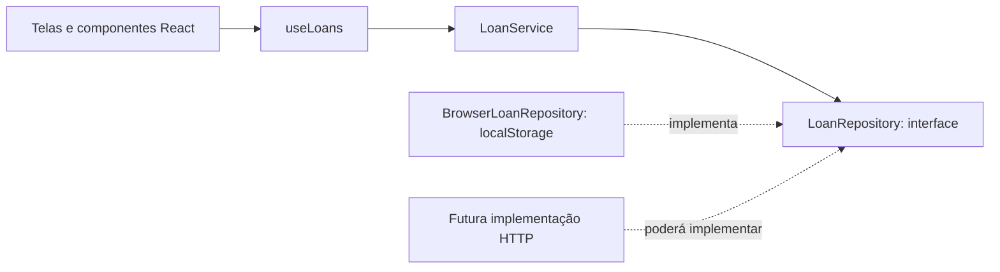

# Arquitetura do EmprestaAí

O projeto desta etapa é um front-end React com dados de demonstração. A organização prepara as regras de empréstimo para uma futura API, sem apresentar `localStorage` como back-end.

## Responsabilidades

- **`src/domain/loan.ts`** define o empréstimo e regras simples de data e situação.
- **`src/domain/LoanService.ts`** concentra criação, edição, devolução e validações. Recebe o repositório no construtor.
- **`src/domain/LoanRepository.ts`** descreve as operações assíncronas de consulta, criação e atualização necessárias ao domínio.
- **`src/infrastructure/BrowserLoanRepository.ts`** implementa esse contrato usando armazenamento local. Os registros iniciais ficam em `demoLoans.ts`.
- **`src/application/useLoans.ts`** coordena o serviço com o estado React e trata o carregamento inicial.
- **`src/pages` e `src/components`** cuidam de navegação, apresentação, formulários e feedback visual.

## Decisões de projeto

1. **Encapsulamento:** o serviço guarda as regras de negócio; a interface não altera registros diretamente.
2. **Responsabilidade única:** componentes não acessam `localStorage`, e o repositório não contém regras de interface.
3. **Inversão de dependência:** `LoanService` depende da interface `LoanRepository`, não de uma classe concreta de armazenamento.
4. **Composição:** a implementação do repositório é injetada no serviço. Não há herança artificial para um domínio pequeno.
5. **Contrato assíncrono:** mesmo o armazenamento local seguindo esse contrato, a futura integração HTTP não exige mudar a assinatura das operações no serviço e nas telas.
6. **Estados explícitos:** o formulário mostra validações e salvamento; a interface diferencia empréstimos em aberto, atrasados e devolvidos.

## Regras verificadas

- Objeto, pessoa e data do empréstimo são obrigatórios.
- Datas precisam ser válidas, e a previsão não pode anteceder o empréstimo.
- Um empréstimo concluído não pode ser editado.
- Confirmar a devolução novamente não muda a data já registrada.
- IDs inexistentes geram erro de domínio.

Esses comportamentos são testados em `src/domain/LoanService.test.ts` com um repositório em memória. O front-end também foi verificado manualmente no navegador: criação, validação, detalhes, devolução, histórico e restauração dos dados de demonstração.

## Próxima etapa

Para o back-end, criar uma implementação HTTP de `LoanRepository` e tratar autenticação e persistência no servidor. O controle de acesso deverá ocorrer na API; esconder botões na interface não substitui autorização no servidor.
