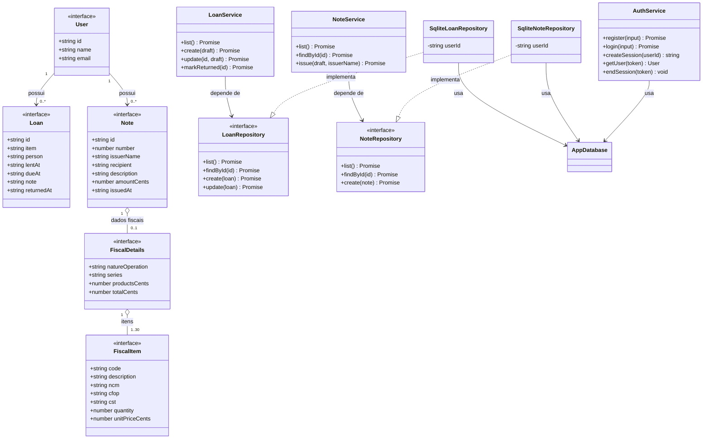
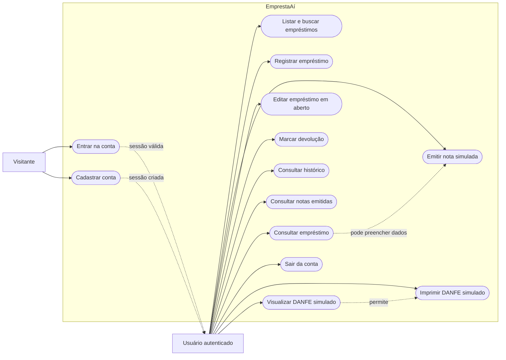
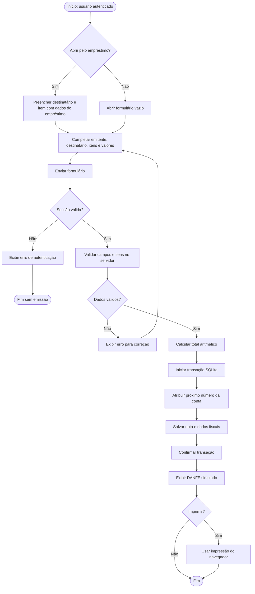
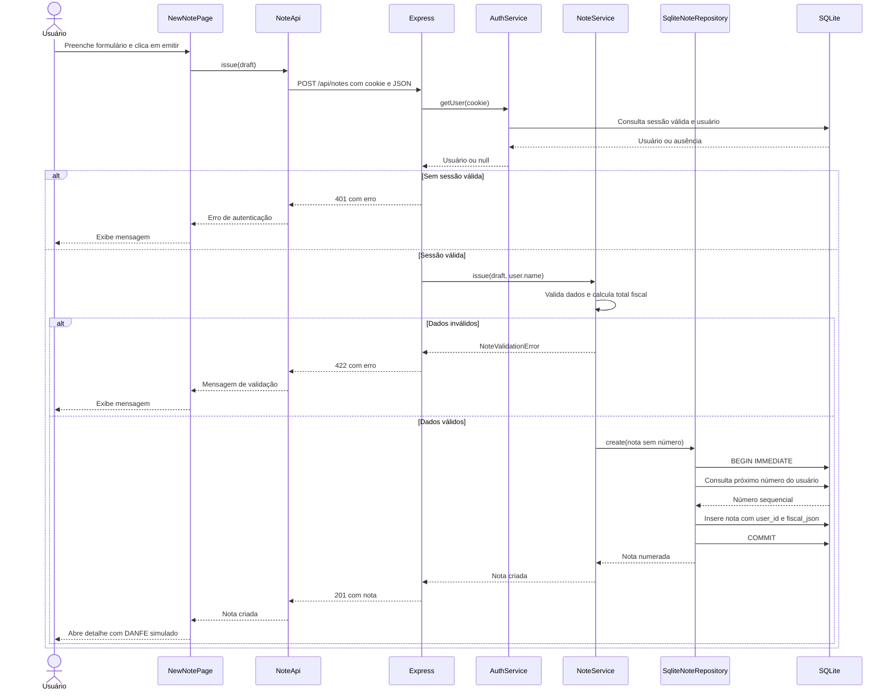

# Diagramas do EmprestaAí

Os quatro diagramas abaixo representam o código atual. Eles podem ser visualizados diretamente no GitHub, que renderiza os blocos Mermaid.

## 1. Diagrama de classes

Mostra as entidades, os serviços de negócio e os contratos de persistência. `Loan`, `Note`, `FiscalDetails` e `FiscalItem` são interfaces TypeScript; as classes de serviço e os repositórios SQLite têm implementação própria. Cada repositório SQLite recebe o ID do usuário autenticado, que limita suas consultas à respectiva conta. Uma nota criada a partir da tela de um empréstimo recebe dados iniciais dele, mas não guarda uma referência permanente ao empréstimo.

## 2. Diagrama de casos de uso

O visitante pode se cadastrar ou entrar. Depois do login, a conta gerencia seus empréstimos e suas notas simuladas. A impressão ocorre no navegador. A nota pode ser iniciada a partir de um empréstimo apenas para preencher destinatário e item.

## 3. Diagrama de atividades

Fluxo de emissão de uma nota fiscal **demonstrativa**. Os campos fiscais são validados no servidor; os valores informados não passam por um motor tributário. O servidor calcula o total aritmético, atribui um número sequencial por conta e salva a nota em uma transação.

## 4. Diagrama de sequência

Detalha a chamada `POST /api/notes` usada pela tela de emissão. Em caso de erro de validação, a API responde `422`; sem sessão válida, responde `401`. A resposta de sucesso é `201` com a nota criada.

**Limite do módulo fiscal:** o DANFE é apenas uma simulação visual. O sistema não gera XML, chave de acesso ou protocolo e não se comunica com a SEFAZ.
